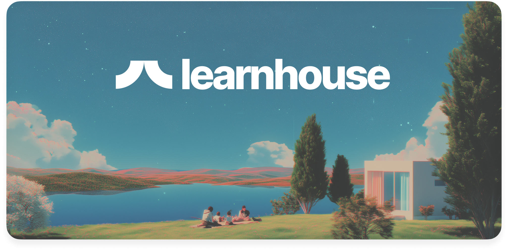
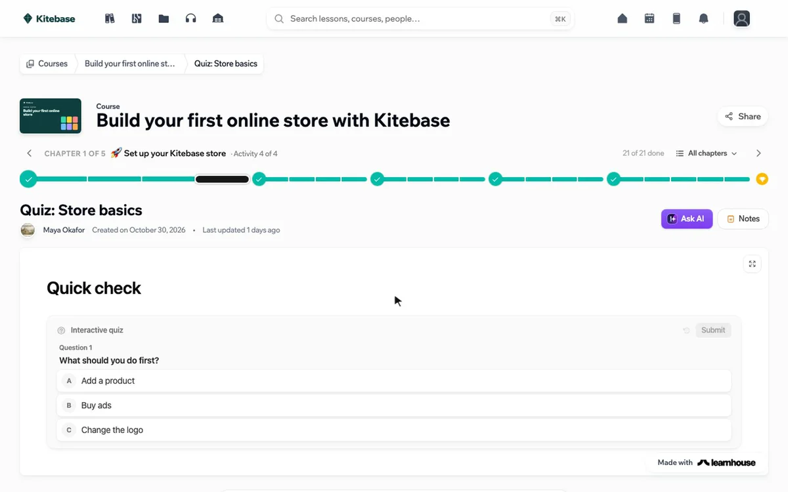

<p align="center">
  <a href="https://learnhouse.app">
    
  </a>
</p>

<p align="center">
  <b>The open-source learning platform.</b><br />
  Write courses like documents, check what stuck, teach with AI, and run it on your own server.
</p>

<p align="center">
  <a href="https://learnhouse.app">Website</a> ·
  <a href="https://docs.learnhouse.app">Docs</a> ·
  <a href="https://university.learnhouse.io">Live academy</a> ·
  <a href="https://discord.gg/CMyZjjYZ6x">Discord</a>
</p>

<p align="center">
  <a href="https://github.com/learnhouse/learnhouse/blob/dev/LICENSE"></a>
  <a href="https://www.npmjs.com/package/learnhouse"></a>
  <a href="https://github.com/learnhouse/learnhouse/stargazers"></a>
</p>

<br />

<p align="center">
  
</p>

## Try it

One command sets up a full instance with Docker. The wizard asks for your domain, database and admin account, then starts everything.

```bash
npx learnhouse@latest setup
```

Want to look around first? [university.learnhouse.io](https://university.learnhouse.io) is a real academy running on LearnHouse, and the [docs](https://docs.learnhouse.app) cover every feature.

## A short tour

### Write the way you think

The editor works like a doc. Type `/` and add text, video, math, flashcards, quizzes, code or embeds, and your co-authors can edit alongside you in real time.

<p align="center">
  
</p>

### Check what stuck

Drop quizzes into any lesson. Build assignments from quizzes, file uploads, forms, short answers and code challenges that run and grade themselves in 30+ languages. Review submissions and grade from one screen.

<p align="center">
  
</p>

### AI that knows the course

Describe a course and get a full outline with chapters and lessons to edit. Learners get a tutor that answers from your content, not from the open web.

<p align="center">
  
</p>

### Everything around the course

Podcasts, certificates on completion, learning paths, communities, collections, custom landing pages, and an interface available in 22 languages.

<p align="center">
  
</p>

## What's inside

<table>
  <tr>
    <td width="50%" valign="top">
      <b>Teach</b><br />
      Courses, chapters and collections<br />
      Block editor with live collaboration<br />
      Quizzes, assignments and grading<br />
      Code exercises with auto-grading<br />
      Podcasts and video<br />
      Learning paths and certificates
    </td>
    <td width="50%" valign="top">
      <b>Run</b><br />
      Communities and discussions<br />
      User groups, roles and permissions<br />
      Custom branding and landing pages<br />
      SEO: metadata, sitemaps, Open Graph<br />
      AI course planner and tutor<br />
      REST API, webhooks and MCP server
    </td>
  </tr>
</table>

Some features are part of the **Enterprise Edition** under a separate license: payments, SSO, multiple organizations, analytics, boards, plays, live sessions, SCORM, LTI and audit logs. See [Enterprise](https://docs.learnhouse.app/enterprise) for details.

## Build on it

LearnHouse is headless-friendly. Use the API from any stack, or drop real LearnHouse activities into your own app:

```bash
npm install @learnhouse/react   # or @learnhouse/vue, @learnhouse/sdk
```

```tsx
import { LearnHouseActivity } from '@learnhouse/react'
import '@learnhouse/react/styles.css'
```

See them running at [demos.learnhouse.app](https://demos.learnhouse.app), or read the package docs in [`packages/`](packages).

## Self-hosting

The CLI handles setup, updates and backups.

```bash
npx learnhouse start     # start services
npx learnhouse update    # update to the latest version
npx learnhouse backup    # back up database, config and uploads
npx learnhouse doctor    # diagnose common issues
```

Needs Node.js 22+ and Docker with Compose v2. Every command is in the [CLI docs](apps/cli/README.md).

## Development

```bash
git clone https://github.com/learnhouse/learnhouse.git
cd learnhouse
npx learnhouse dev
```

This starts PostgreSQL and Redis, installs dependencies, and runs the API, web app and collaboration server with hot reload.

| App | Path | Stack |
| --- | --- | --- |
| Web | `apps/web` | Next.js, React, Tailwind CSS, Tiptap |
| API | `apps/api` | FastAPI, SQLModel, PostgreSQL, Redis |
| Collab | `apps/collab` | Hocuspocus, Yjs |
| CLI | `apps/cli` | Node.js, Commander |
| Packages | `packages/*` | SDK, React and Vue embeds |

## Contributing

Bug reports, fixes and ideas are all welcome. Start with the [contributing guide](CONTRIBUTING.md), pick a [good first issue](https://github.com/learnhouse/learnhouse/issues?q=is%3Aopen+is%3Aissue+label%3A%22good+first+issue%22), or come say hi on [Discord](https://discord.gg/CMyZjjYZ6x).

Found a security issue? Please email **security@learnhouse.app** instead of opening an issue. Our [security policy](https://learnhouse.app/security) explains the process.

## License

LearnHouse is licensed under [AGPL-3.0](LICENSE). Enterprise features are available under a separate Enterprise License.

Made with care by [@swve](https://github.com/swve) and contributors.
