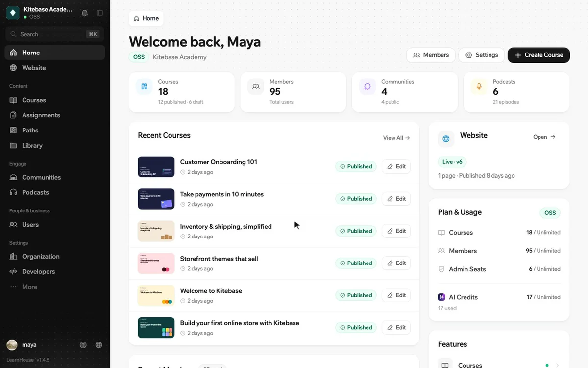
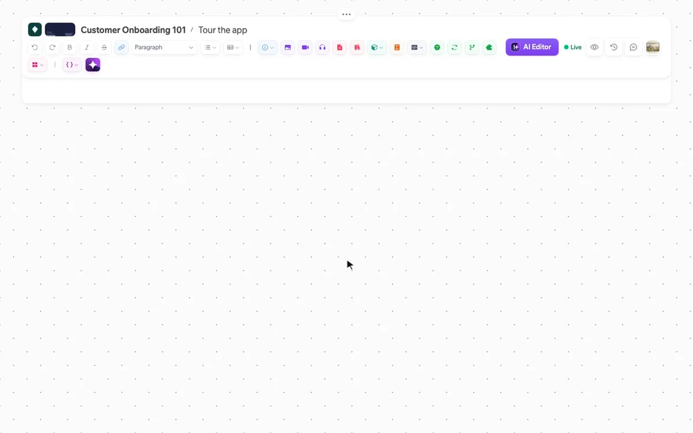
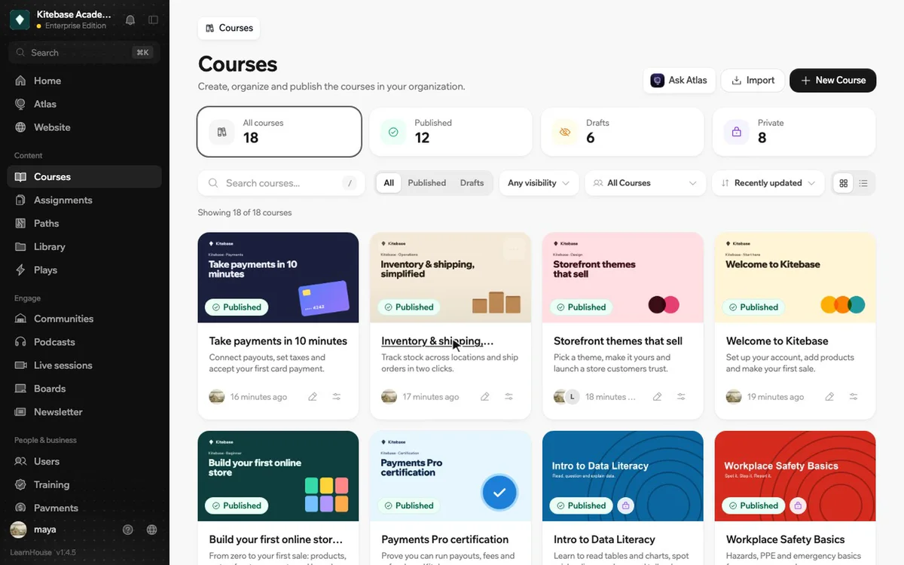
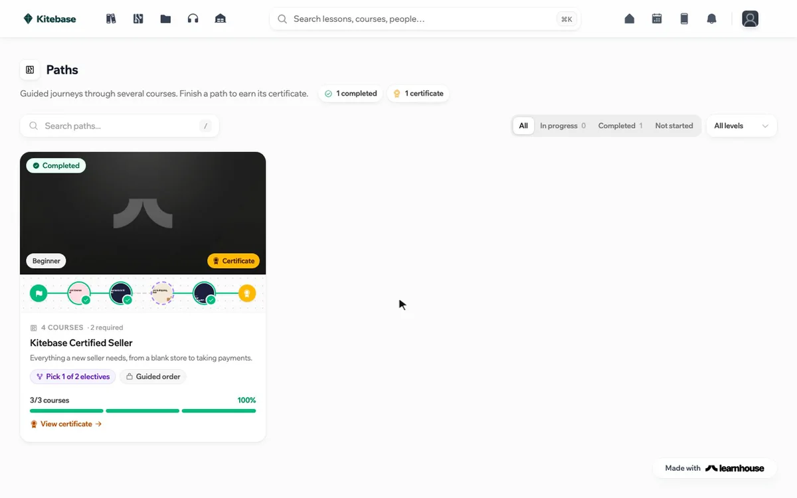

<p align="center">
  <a href="https://learnhouse.app">
    
  </a>
</p>

<p align="center">
  <b>The complete learning platform, built for how people learn now.</b><br />
  A beautiful editor, real assessments, an AI tutor in every lesson, communities, podcasts and your own academy site.<br />
  All in one place, open source, and yours to run.
</p>

<p align="center">
  <a href="https://learnhouse.app">Website</a> ·
  <a href="https://docs.learnhouse.app">Docs</a> ·
  <a href="https://university.learnhouse.io">Live academy</a> ·
  <a href="https://discord.gg/CMyZjjYZ6x">Discord</a>
</p>

<p align="center">
  <a href="https://github.com/learnhouse/learnhouse/blob/dev/LICENSE"></a>
  <a href="https://www.npmjs.com/package/learnhouse"></a>
  <a href="https://github.com/learnhouse/learnhouse/stargazers"></a>
</p>

<br />

<p align="center">
  
</p>

## 🚀 Try it

One command sets up a full instance with Docker. The wizard asks for your domain, database and admin account, then starts everything.

```bash
npx learnhouse@latest setup
```

Want to look around first? [university.learnhouse.io](https://university.learnhouse.io) is a real academy running on LearnHouse, and the [docs](https://docs.learnhouse.app) cover every feature.

## 👀 A short tour

### ✍️ Write the way you think

The editor works like a doc. Type `/` and add text, video, math, flashcards, quizzes, code or embeds, and your co-authors can edit alongside you in real time.

<p align="center">
  
</p>

### ✅ Check what stuck

Drop quizzes into any lesson. Build assignments from quizzes, file uploads, forms, short answers and code challenges that run and grade themselves in 30+ languages. Review submissions and grade from one screen.

<p align="center">
  
</p>

### 🤖 AI that knows the course

Describe a course and get a full outline with chapters and lessons to edit. Learners get a tutor that answers from your content, not from the open web.

<p align="center">
  
</p>

### 🎓 Everything around the course

Podcasts, certificates on completion, learning paths, communities, collections, custom landing pages, and an interface available in 22 languages.

<p align="center">
  
</p>

## 📦 What's inside

| Area | What you get |
| --- | --- |
| 📝 **Editor** | Block editor with live collaboration, templates and version history |
| 📚 **Courses** | Chapters, collections, a shared library, learning paths and certificates |
| 🧪 **Assessments** | Quizzes, assignments, code exercises graded in 30+ languages |
| 🤖 **AI** | Course planner, lesson tutor and grading help, with Gemini or a local model through Ollama |
| 🎙️ **Media** | Video, PDFs and podcasts with an RSS feed |
| 💬 **Communities** | Discussion boards for your learners |
| 👥 **People** | Invites, user groups, roles and permissions |
| 🎨 **Your brand** | Your logo and colors, a landing page builder and SEO |
| 🌍 **Languages** | Interface in 22 languages |
| 🔌 **Integrations** | REST API, API tokens, webhooks and an MCP server |

## 🏢 Enterprise

Everything above is open source and free forever. Teams that sell courses, train staff or plug into a school's systems can add the Enterprise features on top:

| Area | What you get |
| --- | --- |
| ✨ **Atlas** | An AI agent that builds whole courses, edits lessons, translates content and runs scheduled jobs |
| 💳 **Payments** | Sell courses, offer team seats to companies and run an affiliate program |
| 📊 **Analytics** | Learner progress, engagement signals and course health across your academy |
| 🎥 **Live sessions** | Video classes with a shared calendar, built in |
| 🔐 **SSO and SCIM** | Sign in with your identity provider and sync users automatically |
| 🏫 **LTI 1.3 and SCORM** | Plug courses into Canvas, Moodle and other LMSs, and import SCORM packages |
| 📨 **Newsletter and CRM** | Email your learners and keep track of every contact |
| 🧠 **Boards and Plays** | Collaborative whiteboards and interactive, AI-generated activities |
| 🏢 **Multiple organizations** | Run several academies from one install, with audit logs |

See [plans and pricing](https://learnhouse.app/pricing) or [talk to us](https://learnhouse.app/contact).

## 🧩 Build on it

Everything in LearnHouse is reachable from code. Keep your courses in LearnHouse and show them anywhere: your marketing site, a customer portal, a mobile app.

| Package | What it does |
| --- | --- |
| [`@learnhouse/sdk`](packages/sdk) | Typed API client for browsers, Node, Bun, Deno, edge workers and React Native |
| [`@learnhouse/react`](packages/react) | Renders real LearnHouse activities in any React app, plus a `<learnhouse-activity>` custom element for everything else |
| [`@learnhouse/vue`](packages/vue) | The same activities for Vue 3 and Nuxt |

All three are MIT licensed, and each version matches the LearnHouse release it was built from. See them running at [demos.learnhouse.app](https://demos.learnhouse.app).

### ⚛️ Show a lesson in your React app

```bash
npm install @learnhouse/react
```

```tsx
import { LearnHouseActivity } from '@learnhouse/react'
import '@learnhouse/react/styles.css'

export function Lesson() {
  return (
    <LearnHouseActivity
      baseUrl="https://learn.example.com"
      courseId="course_9f2a…"
      activityName="How payouts work"
      theme={{ mode: 'auto', accent: '#4F46E5' }}
      onEvent={(e) => console.log(e.type)}
    />
  )
}
```

Pages, quizzes, flashcards, code playgrounds, math, video and PDFs look and behave the way they do in LearnHouse. Point to an activity by id or by name, restyle it with `theme`, swap any block with `components`, and listen for `ready`, `complete` and media events.

Not using React? The custom element works in plain HTML, Svelte or Angular:

```html
<script type="module">
  import '@learnhouse/react/element'
  import '@learnhouse/react/styles.css'
</script>

<learnhouse-activity base-url="https://learn.example.com" course-id="course_9f2a…" activity-id="activity_0b3c…"></learnhouse-activity>
```

### 💚 Vue and Nuxt

```vue
<script setup lang="ts">
import { LearnHouseActivity } from '@learnhouse/vue'
import '@learnhouse/vue/styles.css'
</script>

<template>
  <LearnHouseActivity base-url="https://learn.example.com" course-id="course_9f2a…" activity-id="activity_0b3c…" />
</template>
```

### 🔌 Talk to the API

```bash
npm install @learnhouse/sdk
```

```ts
import { createClient } from '@learnhouse/sdk'

// On your server, with an API token from your organization's Developers settings
const lh = createClient({ baseUrl: process.env.LEARNHOUSE_URL!, token: process.env.LEARNHOUSE_TOKEN! })

for await (const course of lh.courses.listAll('your-school')) {
  console.log(course.name)
}

const activity = await lh.activities.resolve({ courseId: 'course_9f2a…', activityName: 'How payouts work' })
```

The SDK also handles cookie sessions in the browser, token refresh in React Native, retries, pagination and webhook signature checks. Keep `lh_` API tokens on your server; in the browser, use the signed-in user's session.

LearnHouse also ships webhooks for course and learner events, and an MCP server so AI assistants can read and build courses in your organization.

## 🏠 Self-hosting

The CLI handles setup, updates and backups.

```bash
npx learnhouse start     # start services
npx learnhouse update    # update to the latest version
npx learnhouse backup    # back up database, config and uploads
npx learnhouse doctor    # diagnose common issues
```

Needs Node.js 22+ and Docker with Compose v2. Every command is in the [CLI docs](apps/cli/README.md).

## 🛠️ Development

```bash
git clone https://github.com/learnhouse/learnhouse.git
cd learnhouse
npx learnhouse dev
```

This starts PostgreSQL and Redis, installs dependencies, and runs the API, web app and collaboration server with hot reload.

| App | Path | Stack |
| --- | --- | --- |
| Web | `apps/web` | Next.js, React, Tailwind CSS, Tiptap |
| API | `apps/api` | FastAPI, SQLModel, PostgreSQL, Redis |
| Collab | `apps/collab` | Hocuspocus, Yjs |
| CLI | `apps/cli` | Node.js, Commander |
| Packages | `packages/*` | SDK, React and Vue embeds |

## 🤝 Contributing

Bug reports, fixes and ideas are all welcome. Start with the [contributing guide](CONTRIBUTING.md), pick a [good first issue](https://github.com/learnhouse/learnhouse/issues?q=is%3Aopen+is%3Aissue+label%3A%22good+first+issue%22), or come say hi on [Discord](https://discord.gg/CMyZjjYZ6x).

Found a security issue? Please email **security@learnhouse.app** instead of opening an issue. Our [security policy](https://learnhouse.app/security) explains the process.

## 📄 License

LearnHouse is licensed under [AGPL-3.0](LICENSE). The packages in [`packages/`](packages) are MIT.

Made with care by [@swve](https://github.com/swve) and contributors since 2022 💜
